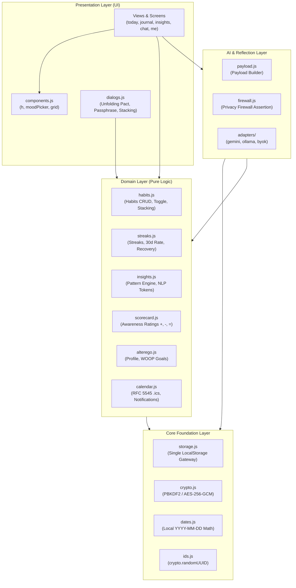
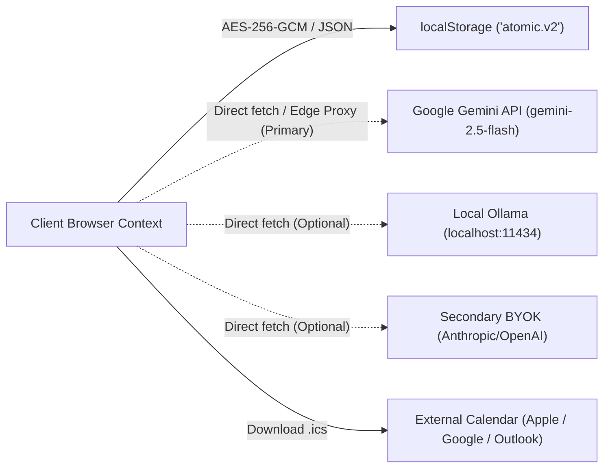
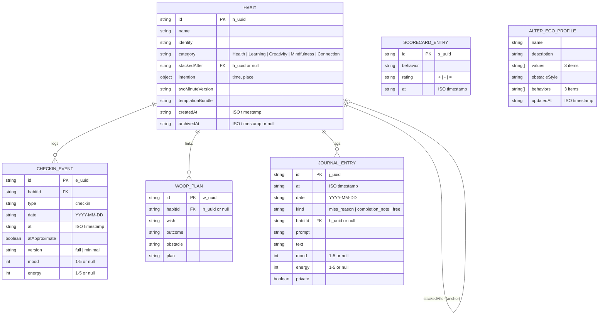

# Architecture Spine — Atomic v2

## Design Paradigm

Atomic v2 follows a **Layered Unidirectional Architecture** (`Core` $\leftarrow$ `Domain` $\leftarrow$ `UI` / `AI`).



- **Core:** Primitive utilities (`storage.js`, `crypto.js`, `dates.js`, `ids.js`). Zero DOM dependencies, zero business logic.
- **Domain:** Pure business logic and algorithmic derivations. Operates on plain state objects. Never imports DOM APIs.
- **AI:** Prompt payload synthesis and transport adapters. Enforces data redaction and word boundaries before egress.
- **UI:** View composition, reactive event listening, DOM rendering, and design token styling.

---

## Invariants & Rules

### AD-1 — Strict Layered Unidirectional Dependency Boundary [ADOPTED]

- **Binds:** All modules across `js/core/`, `js/domain/`, `js/ai/`, `js/ui/`, and `js/main.js`.
- **Prevents:** Circular imports, UI components touching `localStorage` directly, domain logic depending on DOM elements, and untrusted execution contexts triggering direct network calls.
- **Rule:** Module dependency must flow strictly downwards: `UI` $\rightarrow$ `Domain` $\rightarrow$ `Core`; `UI` $\rightarrow$ `AI` $\rightarrow$ `Core`. No module in `Core` or `Domain` may import from `UI`. No module in `Core` may import from `Domain` or `AI`. Direct access to browser globals (`document`, `window`, `localStorage`, `Notification`) is forbidden within `Domain` and `Core` (with the sole exception of `localStorage` inside `js/core/storage.js`).

### AD-2 — Unified Storage Gateway, Migration & State Singleton [ADOPTED]

- **Binds:** `FR-1`, `FR-2`, `FR-4`, `FR-26`, `js/core/storage.js`.
- **Prevents:** Inconsistent state snapshots, race conditions during encryption, bypass of schema validation, and corrupt data overwrites.
- **Rule:** `js/core/storage.js` is the sole module permitted to interact with browser `localStorage`.
  - State is keyed strictly under `'atomic.v2'`.
  - Startup migration: If `'atomic.v2'` is absent and legacy keys (`atomicHabits`, `atomic.state`) exist, the raw legacy payload is preserved in `'atomicHabits_v1_backup'`, migrated idempotently to `schemaVersion: 2` with `atApproximate: true`, and persisted to `'atomic.v2'`.
  - Parse safety: If state cannot be parsed or decrypted, `storage.error` is set, and `storage.save()` aborts all writes to prevent overwriting existing encrypted or unparseable data.

### AD-3 — Append-Only Check-in Event Log with Zero Stored Miss Records [ADOPTED]

- **Binds:** `FR-2`, `FR-3`, `FR-8`, `FR-10`, `FR-11`, `FR-12`, `FR-13`, `js/domain/habits.js`, `js/domain/streaks.js`.
- **Prevents:** Storing negative "miss" records, duplicate daily check-in events, and drifting cached streak/consistency metrics.
- **Rule:**
  - Check-in occurrences are recorded as discrete events in `state.events` with `type: 'checkin'`. Exactly one check-in event is permitted per habit per local calendar date. Toggling off an event permanently deletes that event record.
  - Misses are NEVER stored in state. A miss is dynamically computed at query time: any local calendar date from habit creation date (`createdAt`) to yesterday with no corresponding check-in event is a miss.
  - Streaks, 30-day consistency rates, recovery times, and weekly identity votes are pure runtime projections dynamically calculated from `state.events` and `state.habits`.

### AD-4 — Strict Local Calendar Date Strings (`YYYY-MM-DD`) & Today-Only Check-in [ADOPTED]

- **Binds:** `FR-2`, `FR-8`, `FR-10`, `FR-24`, `js/core/dates.js`, `js/domain/habits.js`.
- **Prevents:** UTC midnight date-flipping, timezone boundary offset bugs, and historical retro-logging.
- **Rule:**
  - All calendar dates stored in `events`, `journal`, and queries must be formatted as local `YYYY-MM-DD` strings derived using local date getters (`getFullYear()`, `getMonth() + 1`, `getDate()`) via `core/dates.js`. UTC getters (`getUTCFullYear()`) are strictly forbidden for calendar dates.
  - Daily check-in logging and Never-Miss-Twice two-minute completions are restricted strictly to the current local calendar date (`date === today()`). The system provides no UI or API to create, edit, or backfill check-in events for past or future dates.

### AD-5 — Client-Side Privacy Firewall, Gemini Primary Cloud Adapter & Direct Network Isolation [ADOPTED]

- **Binds:** `FR-21`, `FR-22`, `FR-23`, `js/ai/payload.js`, `js/ai/firewall.js`, `js/ai/adapters/gemini.js`, `js/ai/adapters/ollama.js`.
- **Prevents:** Accidental transmission of raw journal reflections, transmission of private notes, centralized user tracking, and third-party credential exposure.
- **Rule:**
  - Inbound LLM payload builder (`js/ai/payload.js`) defaults strictly to aggregated numerical and categorical metadata (habit titles, identities, 30-day consistency percentages, active pattern summaries, Alter Ego profile).
  - Unencrypted journal text is excluded by default. Transmitting journal text requires explicit single-turn user opt-in for that specific prompt.
  - Journal entries marked `private: true` are hard-blocked by `firewall.js` and MUST NEVER be included in any outbound payload under any circumstance.
  - **Primary Cloud Adapter:** Google Gemini (`gemini-2.5-flash`) via `js/ai/adapters/gemini.js`. Utilizes standard browser HTTPS `fetch()` to `generativelanguage.googleapis.com` with native CORS support. Designed for direct 1-click Google AI Studio key onboarding during initial launch, with an architectural transition path to a serverless edge proxy (e.g., Cloudflare Worker / Firebase Function) injecting an app-level key for seamless, zero-config public deployment.
  - **On-Device & Secondary Adapters:** Local Ollama on `http://localhost:11434` for local air-gapped execution; secondary BYOK for Anthropic / OpenAI. If provider is `'none'`, system runs purely offline using templated reflective prompts. Responses are capped at 120 words with max 1 actionable suggestion.

### AD-6 — Full-State PBKDF2/AES-256-GCM Envelope with Ephemeral In-Memory Keys [ADOPTED]

- **Binds:** `FR-26`, `js/core/crypto.js`, `js/core/storage.js`.
- **Prevents:** Plaintext data exposure in browser storage, leakage of habit titles or journal reflections on shared computers, and persisting crypto keys in web storage.
- **Rule:**
  - When passphrase protection is enabled in `state.settings.encryptionEnabled`, the entire serialized JSON state is encrypted into an opaque ciphertext string stored in `'atomic.v2'`.
  - Key derivation uses PBKDF2 with HMAC-SHA256, 600,000 iterations, and a fresh 16-byte random salt generated via `crypto.getRandomValues()`.
  - Encryption uses AES-256-GCM with a fresh 12-byte random IV per save.
  - The derived symmetric `CryptoKey` resides strictly in transient JavaScript memory. It is NEVER written to `localStorage`, `sessionStorage`, `IndexedDB`, cookies, or browser caches.
  - On application startup, if encrypted ciphertext is detected, `storage.js` pauses state loading and triggers a modal passphrase prompt.

### AD-7 — Deterministic Pure Statistical Pattern Engine with Proof Payloads [ADOPTED]

- **Binds:** `FR-15`, `FR-16`, `FR-17`, `js/domain/insights.js`.
- **Prevents:** Non-deterministic AI hallucinations for user habits, network dependencies for insight calculation, and opaque algorithmic assertions.
- **Rule:**
  - Behavioral patterns (Weekday Slip $\ge 25\%$, Time-of-Day Rhythm $\ge 60\%$, Streak-Break Precursor $\ge 50\%$, Recovery Window $\ge 3$ misses, Habit Co-occurrence $\ge 25\%$, Mood Correlates $\ge 10$ pairs) and recurring themes (tokens $\ge 4$ chars appearing in $\ge 3$ distinct journal/miss entries across $\ge 8$ total entries) are evaluated via synchronous, pure mathematical functions running strictly in the browser.
  - Every generated discovery object must adhere to a standardized contract:
    `{ id, type, unlocked: boolean, sampleSize: { k, n }, message: string, proof: { ... } }`.
  - The UI must render the collapsible *"Why am I seeing this?"* disclosure using the structured `proof` object, ensuring 100% calculation transparency.

### AD-8 — Zero-Dependency Browser-Native ES Modules & Native Node:Test Execution [ADOPTED]

- **Binds:** `FR-1` to `FR-26`, `package.json`, `index.html`, `tests/run.js`.
- **Prevents:** Build tooling fragility (Webpack/Vite/Babel rot), CDN outages, supply chain risks, and browser-node runtime mismatch.
- **Rule:**
  - The production client application must run entirely via standard browser ECMAScript modules (`<script type="module" src="js/main.js">`) without any build step, bundler, compiler, or external script/font CDN dependency.
  - All styling uses vanilla CSS custom properties adhering to Sally's design tokens in `DESIGN.md`.
  - Automated unit tests must execute directly using Node.js built-in `node:test` and `node:assert/strict` test runner, testing domain and core logic without requiring DOM polyfills or third-party test runners.

---

## Consistency Conventions

| Concern | Convention |
| :--- | :--- |
| **Naming (Files)** | Strict kebab-case for all source and test files (e.g., `habit-detail.js`, `storage.js`, `insights.test.js`). |
| **Naming (Code)** | camelCase for variables, functions, and object properties; PascalCase for classes/types; UPPER_SNAKE_CASE for immutable constants. |
| **Identifier Generation** | Prefixed UUIDs via `crypto.randomUUID()`: Habit `h_<uuid>`, Event `e_<uuid>`, Journal `j_<uuid>`, Scorecard `s_<uuid>`, WOOP `w_<uuid>`. |
| **Data & Dates** | Local calendar strings `YYYY-MM-DD` for all day records; ISO 8601 UTC strings (`new Date().toISOString()`) for timestamps (`at`). |
| **Mood & Energy** | 5-point discrete integer scale (`1` to `5` or `null`). Red colors strictly prohibited for negative or missed states. |
| **Categories** | Fixed 5-element domain enum: `Health`, `Learning`, `Creativity`, `Mindfulness`, `Connection`. `[ASSUMPTION: Custom categories deferred to v2]`. |
| **Error Handling** | Fail-safe quarantine: `storage.js` sets `storage.error` and refuses to overwrite unreadable storage. UI displays calm diagnostic banners. |
| **DOM Creation** | Pure functional element factory `h(tag, attrs, ...children)` with declarative event handlers and boolean attribute handling. |
| **Theme System** | Pure CSS custom properties on `document.documentElement` (`data-theme="paper" \| "night"`, `data-warm="true \| false"`). |

---

## Stack

| Name | Version |
| :--- | :--- |
| ECMAScript (Browser Native) | ES2022+ (Native Modules, top-level await, crypto.randomUUID) |
| Node.js (Test Runner) | v20.0.0+ (`node:test`, `node:assert/strict`) |
| Web Cryptography API | W3C Recommendation (PBKDF2, AES-256-GCM, crypto.subtle) |
| Google Gemini REST API | v1beta (`gemini-2.5-flash` via Google AI Studio) |
| iCalendar Specification | RFC 5545 v2.0 (`.ics` event export) |
| Web Notifications API | W3C Living Standard (In-tab `Notification` API) |
| Web Storage API | HTML Living Standard (`localStorage` key: `atomic.v2`) |

---

## Structural Seed

### System Context & Runtime Architecture



### Core Entity Relationships (ERD)



### Directory Source Tree

```text
atomic_v2/
  index.html                 # Single-page HTML entrypoint with semantic layout
  style.css                  # Design tokens, Paper/Night themes, stationery styling
  package.json               # ES module package definition (type: module)
  README.md                  # Project overview and run instructions
  js/
    main.js                  # Application bootstrapper, hash router, global listeners
    core/
      storage.js             # Sole localStorage accessor, schema migration, singleton state
      crypto.js              # PBKDF2 key derivation & AES-256-GCM encryption
      dates.js               # Local YYYY-MM-DD date arithmetic & day calculations
      ids.js                 # Prefixed crypto.randomUUID generator
    domain/
      habits.js              # Habit CRUD, today check-in toggling, stacking resolution
      streaks.js             # Current/longest streak, 30d consistency rate, recovery time
      insights.js            # Pure statistical pattern engine & recurring-theme NLP tokenizer
      scorecard.js           # Scorecard behavior tracking & awareness ratings (+, -, =)
      alterego.js            # Alter Ego profile state & WOOP goal planning
      calendar.js            # RFC 5545 .ics calendar generator & in-tab reminder timers
    ai/
      payload.js             # Aggregated metadata builder & privacy firewall filtration
      firewall.js            # Safety validator: private:true exclusion, 120-word boundary
      adapters/
        gemini.js            # Direct browser fetch to Google Gemini REST API (Primary)
        ollama.js            # Direct browser fetch to http://localhost:11434
        byok.js              # Direct browser fetch to Anthropic / OpenAI endpoints
    ui/
      components.js          # Declarative DOM builder h(), moodPicker, 14-day strip, live region
      theme.js               # Theme applicator (Paper / Night / Warm tint)
      today.js               # Today view, Stamp & Ledger cards, Never-Miss-Twice nudge rows
      journal.js             # Ruled stationery journal view, prompt bank, entry history
      insights.js            # Discoveries feed, 7-Day Pulse, collapsible proof disclosure cards
      chat.js                # Dual-mode chat (Mirror / Future-Self), persistent privacy chip
      me.js                  # Identity portfolio, WOOP list, Passphrase crypto, export/import
      habit-detail.js        # 12-week contribution grid & habit configuration form
      dialogs.js             # Unfolding Pact ritual, Stacking prompt, Passphrase modal
  tests/
    run.js                   # Node test runner entrypoint
    domain/
      habits.test.js         # Habit management & stacking tests
      streaks.test.js        # Streak, consistency, and recovery window tests
      insights.test.js       # Statistical pattern & NLP tokenization tests
      calendar.test.js       # RFC 5545 .ics generation tests
    core/
      dates.test.js          # Local date calculation & leap year / DST tests
      storage.test.js        # Schema migration & storage error isolation tests
```

---

## Capability → Architecture Map

| Capability / Requirement | Lives in | Governed by |
| :--- | :--- | :--- |
| **FR-1:** Single Storage Gateway | `js/core/storage.js` | AD-1, AD-2 |
| **FR-2:** Event-Driven Check-in Log | `js/core/storage.js`, `js/domain/habits.js` | AD-2, AD-3 |
| **FR-3:** Dynamic Miss Computation | `js/domain/streaks.js`, `js/domain/habits.js` | AD-3, AD-4 |
| **FR-4:** Lossless Legacy Migration | `js/core/storage.js` | AD-2 |
| **FR-5:** Identity-Centric Habit Setup | `js/domain/habits.js`, `js/ui/dialogs.js` | AD-1, AD-3 |
| **FR-6:** Implementation Intention & Two-Minute Fallback | `js/domain/habits.js`, `js/ui/today.js` | AD-1, AD-3 |
| **FR-7:** Habit Stacking & Cascading Prompts | `js/domain/habits.js`, `js/ui/dialogs.js` | AD-1, AD-3 |
| **FR-8:** Today-Only Check-In & Undo | `js/domain/habits.js`, `js/ui/today.js` | AD-3, AD-4 |
| **FR-9:** Micro-Mood & Reflection Capture | `js/ui/components.js`, `js/ui/today.js` | AD-1, AD-3 |
| **FR-10:** Never-Miss-Twice Nudge | `js/domain/habits.js`, `js/ui/today.js` | AD-3, AD-4 |
| **FR-11:** 30-Day Consistency Rate & Recovery Window | `js/domain/streaks.js`, `js/ui/today.js` | AD-3, AD-7 |
| **FR-12:** Weekly Identity Vote Aggregation | `js/domain/streaks.js`, `js/ui/today.js` | AD-3, AD-4 |
| **FR-13:** 14-Day Strip & 12-Week Contribution Grid | `js/ui/components.js`, `js/ui/habit-detail.js` | AD-1, AD-3 |
| **FR-14:** Habit Scorecard (`+`, `-`, `=`) | `js/domain/scorecard.js`, `js/ui/today.js` | AD-1 |
| **FR-15:** Pure Pattern Engine | `js/domain/insights.js`, `js/ui/insights.js` | AD-7 |
| **FR-16:** Recurring-Theme NLP Detector | `js/domain/insights.js`, `js/ui/insights.js` | AD-7 |
| **FR-17:** Weekly Review Protocol | `js/domain/insights.js`, `js/ui/insights.js` | AD-1, AD-7 |
| **FR-18:** Alter Ego Profile | `js/domain/alterego.js`, `js/ui/me.js` | AD-1 |
| **FR-19:** Offline Scenario Simulator | `js/domain/alterego.js`, `js/ui/chat.js` | AD-1, AD-5 |
| **FR-20:** WOOP Goal & Obstacle Planning | `js/domain/alterego.js`, `js/ui/me.js` | AD-1 |
| **FR-21:** Dual Conversation Modes (Mirror & Future-Self) | `js/ai/payload.js`, `js/ui/chat.js` | AD-5 |
| **FR-22:** Privacy Firewall & Payload Transparency | `js/ai/payload.js`, `js/ai/firewall.js` | AD-5 |
| **FR-23:** Provider Adapter Architecture (Gemini / Ollama / BYOK) | `js/ai/adapters/`, `js/ui/me.js` | AD-1, AD-5 |
| **FR-24:** Standard RFC 5545 `.ics` Export | `js/domain/calendar.js`, `js/ui/me.js` | AD-1, AD-4 |
| **FR-25:** In-Tab Web Notifications | `js/domain/calendar.js`, `js/main.js` | AD-1, AD-4 |
| **FR-26:** Full-State Passphrase Encryption | `js/core/crypto.js`, `js/core/storage.js` | AD-2, AD-6 |

---

## Deferred

The following concerns are intentionally pushed down or out of scope for the Atomic v2 client release:

1. **Multi-Device CRDT / Cloud Sync:** Deferred to Phase 6 server release. Client v1 relies strictly on JSON export/import and passphrase cryptography. Rationale: Avoids premature backend complexity and guarantees 100% zero-knowledge data sovereignty for v1.
2. **Custom Habit Categories:** Deferred to future minor release. The 5 fixed categories (Health, Learning, Creativity, Mindfulness, Connection) cover the identity taxonomy without requiring category management CRUD.
3. **Web Push Background Service Worker:** Deferred. RFC 5545 `.ics` exports into native OS calendar apps and in-tab `Notification` API sufficiently handle reminders without maintaining persistent background service worker processes.
4. **Social Sharing & Leaderboards:** Explicit Non-Goal. Banned by product philosophy to prevent comparison shaming and streak gaming.
