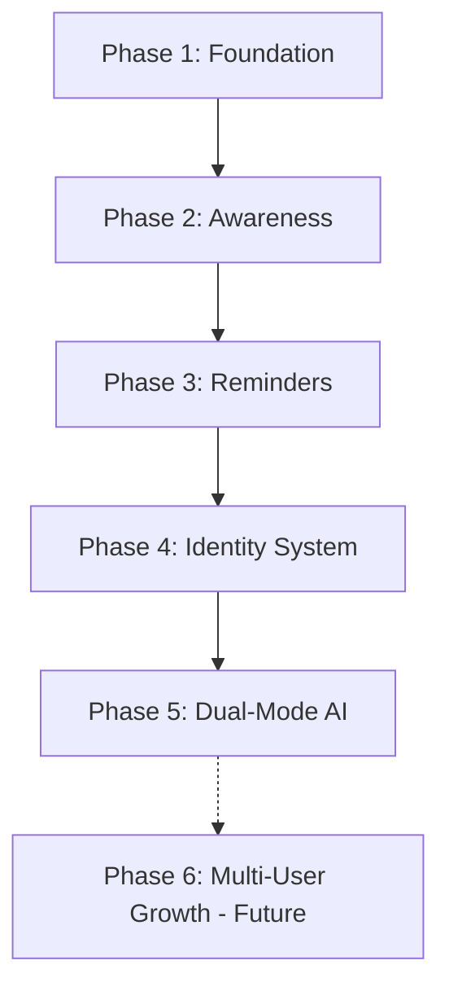

# PRD: Atomic v2 — Identity-Based Habit Tracker

## 0. Document Purpose
This Product Requirements Document (PRD) defines the functional capabilities, behavioral expectations, user journeys, and core guardrails for **Atomic v2**, an identity-based habit tracker grounded in James Clear’s *Atomic Habits*. It serves as the baseline for system architecture ([`bmad-architecture`](file:///Users/rydwandasilva/My-Projects/atomic_v2/.agent/skills/bmad-architecture/SKILL.md)), UX and visual design refinement ([`bmad-ux`](file:///Users/rydwandasilva/My-Projects/atomic_v2/.agent/skills/bmad-ux/SKILL.md)), and test-driven implementation ([`bmad-build`](file:///Users/rydwandasilva/My-Projects/atomic_v2/.agent/skills/bmad-build/SKILL.md)). 

Technical specifications, state JSON schemas, algorithmic thresholds, and cryptographic parameters are preserved in [`addendum.md`](file:///Users/rydwandasilva/My-Projects/atomic_v2/_bmad-output/planning-artifacts/prds/prd-atomic_v2-2026-11-01/addendum.md). Audit logs and decisions are maintained in [`.memlog.md`](file:///Users/rydwandasilva/My-Projects/atomic_v2/_bmad-output/planning-artifacts/prds/prd-atomic_v2-2026-11-01/.memlog.md).

---

## 1. Vision
Most habit trackers act as passive spreadsheets or digital slot machines: they obsess over checklist completion, streak maintenance, and punitive shame when a day is skipped. They encourage habit hoarding without fostering genuine self-awareness.

**Atomic v2** exists to **bring the unconscious into consciousness**. Rather than merely recording behavior volume, Atomic enables users to see in real-time *who they are becoming*. It treats habits as votes for a chosen identity, reframes missed days as valuable diagnostic data rather than moral failures, and provides pattern detection so users interrupt unconscious autopilot spirals before losing momentum. 

Through its local-first architecture and dual-mode AI reflection, Atomic gives the user a trusted sanctuary to interact with both their current behavioral reality (**Mirror Mode**) and their aspired future self (**Alter Ego Mode**).

---

## 2. Target User & Journeys

### 2.1 Jobs To Be Done (JTBD)
- **Functional:** Track daily behavioral votes toward specific identities without friction; seamlessly stack habits to leverage automatic routines; preserve an auditable personal habit history.
- **Emotional:** Break free from self-criticism and guilt loops after breaking a streak; feel a quiet, grounded sense of progress rooted in identity rather than streak numbers.
- **Contextual / Behavioral:** Spot recurring contextual triggers (e.g., "I always miss meditation on Thursday evenings when tired") before falling into habitual avoidance; consult a calm reflection partner when facing obstacles.
- **Privacy:** Keep intimate personal reflections, mental roadblocks, and daily vulnerabilities strictly on the local device, guarded by zero-knowledge encryption.

### 2.2 Non-Users (v1)
- **Competitive Gamers:** Users seeking leaderboards, public badges, streak battles, or social competition.
- **Complex Multi-Step Task Managers:** Users looking for nested project management, Jira-style task tracking, or recurring sub-task checklists.
- **Cloud-Synced Multi-Device Users (v1):** Users requiring instantaneous live syncing across multiple untrusted web browsers prior to the Phase 6 server release.

### 2.3 Key User Journeys

#### UJ-1: Daily Check-In & Micro-Reflection
- **Persona & Context:** Marcus, an aspiring writer balancing full-time work, opens Atomic in the evening.
- **Entry State:** Today screen active; habits displayed with current streak and 30-day consistency rate.
- **Path:** Marcus taps "Mark done today" on "Read 10 pages · A reader". The card transitions smoothly to done state. A gentle prompt asks: "How did that feel?" with 5 neutral mood buttons and an optional note prompt. Marcus taps mood level 4, types "Focused despite long day", and taps save.
- **Climax:** The Today header updates: *"15 votes this week for a reader"*.
- **Resolution:** If a stacked habit exists ("Review draft · stacked after Reading"), a stacking dialog gently offers: *"Log it"* or *"Not now"*.
- **Edge Case:** Marcus tapped by mistake; he immediately taps "Done. Tap to undo", reverting the check-in and removing the event without penalty.

#### UJ-2: Never-Miss-Twice Intervention
- **Persona & Context:** Sarah missed her morning meditation yesterday due to an early morning commute.
- **Entry State:** Sarah opens Atomic on the Today tab the following morning.
- **Path:** The "Mindfulness" card surfaces the Never-Miss-Twice nudge row: *"Yesterday was a miss. Today is the day that counts. Try the two-minute version: Sit quietly for 1 minute."* 
- **Climax:** Rather than feeling overwhelmed by a 20-minute commitment, Sarah taps *"Do the 2-minute version"*.
- **Resolution:** The check-in is logged as a `minimal` version event. Her streak remains intact; the contribution cell renders at 55% tint; Sarah avoids the downward spiral of two consecutive misses.

#### UJ-3: Discovering an Autopilot Pattern
- **Persona & Context:** David notices he repeatedly loses momentum on his fitness habit despite good intentions.
- **Entry State:** David navigates to the **Insights** tab on a Sunday afternoon.
- **Path:** The Discoveries feed displays an unlocked insight card: *"Workout seems to slip on Thursdays: missed 4 of 5 (Based on 5 Thursdays)."* David taps *"Why am I seeing this?"* to inspect the exact numbers. He taps *"Write reflection"*.
- **Climax:** David recognizes that Thursday late-night team syncs drain his energy, prompting him to move workout times to Friday mornings.
- **Resolution:** A journal reflection is saved, and David adjusts the habit intention from Thursday evening to Friday morning.

#### UJ-4: Mirror Mode Interaction (Current Self)
- **Persona & Context:** Elena feels busy all week but feels ungrounded and unsure if her routines are actually helping.
- **Entry State:** Elena navigates to the **Chat** tab and selects **Mirror Mode**.
- **Path:** Elena types: *"How consistent have I actually been this month with deep work?"* The persistent privacy chip confirms: *"Summary sent to Ollama (Aggregated stats only)"*.
- **Climax:** The LLM responds in concise, non-judgmental UI voice: *"Over the last 30 days, Deep Work has an 82% consistency rate (18 check-ins). Your check-ins cluster in the morning between 08:00 and 10:00. However, after missed days, your average recovery time is 2.3 days. What is happening on that second day?"*
- **Resolution:** Elena reflects on the prompt and sets an intention in her Journal.

#### UJ-5: Alter Ego Dialogue (Ideal Future Self)
- **Persona & Context:** Alex faces high friction starting a challenging creative writing project.
- **Entry State:** Alex opens **Chat**, toggles to **Future-Self Mode**, and clicks *"Ask my future self about a situation"*.
- **Path:** Alex enters: *"I'm sitting at my desk feeling totally blocked and want to scroll Twitter."* 
- **Climax:** Drawing on Alex's defined Alter Ego values (*"Presence, Courage, Play"*) and obstacle strategy (*"Writes one bad sentence to break the dam"*), the future self responds in reflective serif voice: *"Remember that perfection is just fear in a suit. What is the worst, most messy sentence you could put on paper right now? Write just that one."*
- **Resolution:** Alex closes the app inspired, writes the first line, and logs a micro-win.

---

## 3. Glossary
*Downstream workflows, architecture documents, and code MUST use these terms verbatim:*

- **Habit:** A specific behavioral routine tied to an identity, categorized under one of five fixed domains (Health, Learning, Creativity, Mindfulness, Connection).
- **Identity:** The overarching person the user is becoming (e.g., "A reader", "A thoughtful partner", "An athlete"). Displayed prominently on each habit card.
- **Identity Vote:** Any completed check-in event. Each check-in counts as one vote cast toward the linked identity.
- **Check-in Event:** A discrete, timestamped record documenting the execution of a habit on a local calendar date, tagged with version (`full` or `minimal`), mood, and optional energy.
- **Two-Minute Version:** A miniaturized fallback version of a habit requiring minimal activation energy, used in Never-Miss-Twice interventions.
- **Temptation Bundle:** A linked pairing of a required habit with an immediate pleasure or indulgence (e.g., "Only drink favorite tea while writing").
- **Stacked Habit:** A habit explicitly linked to trigger immediately after the completion of an anchor habit (`stackedAfter`).
- **Miss:** An absence of a check-in event for an active habit on a past calendar date between its creation date and yesterday. Misses are computed dynamically and never stored as negative records.
- **Recovery Time:** The average number of calendar days elapsed between a missed day and the subsequent check-in for that habit.
- **Never-Miss-Twice:** A core behavioral rule: missing one day is an accident; missing two days in a row is the start of a new, negative habit.
- **Scorecard:** A list of daily micro-behaviors rated by the user as positive (`+`), negative (`-`), or neutral (`=`) relative to desired identity.
- **Pattern / Discovery:** An algorithmically surfaced behavioral hypothesis (e.g., weekday slip, time-of-day clustering) accompanied by sample size and transparency rationale.
- **WOOP:** A structured goal-setting exercise: Wish, Outcome, Obstacle, Plan (*"If [Obstacle], then I will [Action]"*).
- **Alter Ego:** The user’s explicitly defined ideal future self, characterized by core values, behavioral archetypes, and obstacle-handling philosophy.
- **Mirror Mode:** An AI reflection mode that analyzes aggregated behavioral metrics and reflects patterns back to the user without lecturing.
- **Future-Self Mode:** An AI persona mode where the LLM responds in character as the user's defined Alter Ego, adhering to the user's stated principles.
- **Privacy Firewall:** The local data filtration pipeline ensuring raw journal text is never transmitted to an external LLM without explicit single-turn user opt-in.

---

## 4. Features & Functional Requirements

### 4.1 Data Architecture & Storage Engine (Foundation)
**Description:** A pure, decoupled data layer managing an append-only event log, local storage persistence, cryptographic protection, and migration from legacy v1 structures. Realizes UJ-1, UJ-2, UJ-4.

#### FR-1: Single Storage Gateway
The system MUST funnel all persistent read and write operations exclusively through a unified storage module ([`storage.js`](file:///Users/rydwandasilva/My-Projects/atomic_v2/js/core/storage.js)).
- **Consequences:** No UI component or domain logic module accesses `localStorage` directly.
- **Out of Scope:** Direct remote database networking in v1.

#### FR-2: Event-Driven Check-in Log
The system MUST record check-in occurrences as discrete events in an event log (`state.events`) containing `id`, `habitId`, `date` (local `YYYY-MM-DD`), `at` (ISO timestamp), `atApproximate` (boolean), `version` (`full` | `minimal`), and optional `mood` (1–5) and `energy` (1–5).
- **Consequences:** At most one check-in event per habit per local calendar date. Deleting or toggling off an event completely deletes that record.

#### FR-3: Dynamic Miss Computation
The system MUST compute habit misses dynamically on runtime queries.
- **Consequences:** The system stores zero negative "miss records". A miss is derived mathematically if `date` $\in [\text{createdAt}, \text{yesterday}]$ and no corresponding check-in event exists.

#### FR-4: Lossless Legacy Migration
The system MUST automatically detect legacy `atomicHabits` state, back up the raw string to `atomicHabits_v1_backup`, and transform all habits and completions into `schemaVersion: 2` with `atApproximate: true`.
- **Consequences:** Migration must be idempotent and must never overwrite an existing `atomic.v2` key.

---

### 4.2 Habit Setup & Atomic Design
**Description:** Habit creation capturing the full psychology of *Atomic Habits*: identity alignment, implementation intentions, two-minute fallbacks, temptation bundling, and habit stacking. Realizes UJ-1, UJ-2.

#### FR-5: Identity-Centric Habit Definition
Users can create, edit, archive, and delete habits with a name, identity statement, and category selection.
- **Consequences:** Categories are restricted to 5 fixed options: Health, Learning, Creativity, Mindfulness, Connection. [ASSUMPTION: Custom categories remain deferred to v2]. Deletion requires standard browser confirmation.

#### FR-6: Implementation Intention & Two-Minute Fallback
Users can optionally specify an Implementation Intention (time and place), a Two-Minute Version text string, and a Temptation Bundle text string.
- **Consequences:** When specified, the habit card renders the intention sentence: *"I will {name} at {time} in {place}."*

#### FR-7: Habit Stacking & Cascading Prompts
Users can configure a habit to trigger after an existing habit (`stackedAfter`).
- **Consequences:** Upon completing the anchor habit, the system opens a native `<dialog>` presenting all stacked habits with individual "Log it" and "Not now" actions. Logging a stacked habit recursively triggers any child habits stacked after it.

---

### 4.3 Daily Check-In, Mood & Never-Miss-Twice
**Description:** One-tap logging for today only, capturing emotional state and preventing consecutive misses. Realizes UJ-1, UJ-2.

#### FR-8: Today-Only Check-In & Undo
Users can toggle check-ins exclusively for the current local calendar date (`date === today()`).
- **Consequences:** Tapping an uncompleted habit creates a check-in event. Tapping a completed habit removes today's event, restoring previous streak and state.

#### FR-9: Micro-Mood & Reflection Capture
Following a check-in, the card displays a 5-point neutral mood selector (1 = Low, 5 = High) and an optional prompt to add a note to the journal.
- **Consequences:** Selecting mood updates the check-in event in place. Notes are saved to `state.journal` with `kind: "completion_note"` and tagged with the habit ID.

#### FR-10: Never-Miss-Twice Nudge
The system MUST evaluate whether a habit was missed yesterday and remains unlogged today.
- **Consequences:** If active, the card displays a calm nudge offering the two-minute version. Completing the two-minute version records a `version: "minimal"` check-in, preserving streak continuity. Tapping "Not today" suppresses the nudge until the next calendar date.

---

### 4.4 Consistency Metrics & Visual Grids
**Description:** Quantitative visual feedback reinforcing identity progress without gamification or shame. Realizes UJ-1, UJ-3.

#### FR-11: 30-Day Consistency Rate & Recovery Window
The system MUST compute and display the 30-day consistency rate (completed days $\div$ days active up to 30) and the average Recovery Time (days from miss to next check-in, displayed once $\ge 3$ misses occur).
- **Consequences:** Consistency rate is presented as an integer percentage next to current streak on every card.

#### FR-12: Weekly Identity Vote Aggregation
The system MUST sum all check-in events across the rolling last 7 days grouped by normalized identity statement.
- **Consequences:** The Today screen displays the leading identity in the primary greeting: *"X votes this week for {identity}"*.

#### FR-13: 14-Day Strip & 12-Week Contribution Grid
Habit cards display a 14-day trailing check-in strip; expanding the habit detail reveals a full 12-week grid (Sunday to Saturday rows, oldest week left).
- **Consequences:** Minimal check-ins render at 55% fill opacity. Empty cells render in neutral `--grid-empty` color. Red fill is strictly forbidden.

---

### 4.5 Awareness Engine: Scorecard, Patterns & Review
**Description:** Pure client-side analytical routines that expose unconscious behavioral tendencies and provide weekly synthesis. Realizes UJ-3.

#### FR-14: Habit Scorecard
Users can log daily behaviors and assign awareness ratings: Positive (`+`), Negative (`-`), or Neutral (`=`) based on whether the action reinforces their desired identity.
- **Consequences:** Scorecard maintains sequential order and summarizes counts: *"{n} positive, {n} negative, {n} neutral"*.

#### FR-15: Pure Pattern Engine
The system MUST run deterministic pattern-matching functions ([`insights.js`](file:///Users/rydwandasilva/My-Projects/atomic_v2/js/domain/streaks.js)) without invoking external AI or network calls.
- **Consequences:** Evaluates weekday variance ($\ge 25\%$ gap), time-of-day clustering ($\ge 60\%$), streak-break precursors ($\ge 50\%$), habit co-occurrences ($\ge 25\%$), and mood correlates. Every pattern card includes explicit sample size and a collapsible *"Why am I seeing this?"* proof disclosure. Locked patterns show progress towards unlock criteria.

#### FR-16: Recurring-Theme NLP Detector
The system MUST scan all journal entries and miss notes to identify words repeated across $\ge 3$ distinct entries, excluding words $< 4$ letters and common English stopwords.
- **Consequences:** Unlocks after 8 entries and lists the top 10 recurring words with counts and entry links without editorializing.

#### FR-17: Weekly Review Protocol
The system MUST make the Weekly Review card sequence available from Sunday 18:00 local time through the following week for any user with $\ge 3$ days of logged activity.
- **Consequences:** Guides the user through (1) weekly votes and consistency, (2) the strongest unlocked insight, (3) a theme-derived reflection, and (4) an open intention prompt saved as a journal entry.

---

### 4.6 Identity System & Alter Ego
**Description:** Framework for articulating the ideal future self, simulating challenging scenarios, and formulating WOOP obstacle plans. Realizes UJ-5.

#### FR-18: Alter Ego Profile
Users can define an Alter Ego profile consisting of an optional name, rich narrative description, 3 core values, an obstacle handling philosophy, and 3 specific behavioral habits.
- **Consequences:** Requires at least description and 3 behaviors before unlocking Future-Self chat mode.

#### FR-19: Offline Scenario Simulator
Before an LLM provider is connected, the scenario simulator MUST generate templated self-reflection prompts mapping the user's input scenario to their Alter Ego's obstacle style and 3 defined behaviors.
- **Consequences:** System never fabricates advice outside user-provided profile parameters.

#### FR-20: WOOP Goal & Obstacle Planning
Users can author WOOP entries (Wish, Outcome, Obstacle, Plan: *"If {obstacle}, then I will {action}"*) with an optional link to a specific habit.
- **Consequences:** Saved plans appear as contextual hints on the corresponding habit card and in Never-Miss-Twice nudges.

---

### 4.7 Dual-Mode AI Reflection Layer & Privacy Firewall
**Description:** Client-directed LLM integration providing objective data reflection (Mirror Mode) and archetypal identity coaching (Future-Self Mode) behind a strict privacy firewall. Realizes UJ-4, UJ-5.

#### FR-21: Dual Conversation Modes
The Chat interface MUST support two distinct, togglable modes:
1. **Mirror Mode:** Reflects empirical habit metrics, consistency rates, and detected patterns using UI voice.
2. **Future-Self Mode:** Emulates the user's Alter Ego, offering advice strictly grounded in the user's defined values and obstacle techniques using Identity voice.
- **Consequences:** Both modes are bounded by system prompts enforcing concise replies ($< 120$ words), single-suggestion limits, and mandatory crisis disclaimers for expressions of acute distress.

#### FR-22: Privacy Firewall & Payload Transparency
The system MUST default to transmitting aggregated numerical and categorical metadata only.
- **Consequences:** Raw journal text is filtered out by default. Including journal text requires a manual, single-turn checkbox selection. Entries flagged `private: true` are never transmitted. A persistent privacy chip allows users to preview the exact JSON payload prior to submission.

#### FR-23: Flexible Provider Adapter Architecture
Users can configure an LLM provider in Me > Settings:
- **None (Default):** Chat tab displays offline templated reflection.
- **Google Gemini (Primary Cloud Adapter):** Direct browser-to-Google HTTPS requests to `generativelanguage.googleapis.com` using Gemini 2.5 Flash. Native browser CORS support, generous free tier via Google AI Studio 1-click key generation, and seamless architectural transition path to edge proxy injection for zero-config public launch.
- **Local Ollama:** Direct HTTP requests to `http://localhost:11434` on the user's local machine for air-gapped on-device inference.
- **Bring-Your-Own API Key (BYOK):** Direct browser HTTPS requests to other providers (e.g. Anthropic, OpenAI) as secondary options.
- **Consequences:** API keys are stored in `state.settings.ai` and encrypted when encryption is active. Zero requests transit developer-operated servers in v1.

---

### 4.8 Reminders & Calendar Integration
**Description:** Context-aware, low-friction prompts to trigger habits at intended times.

#### FR-24: Standard RFC 5545 `.ics` Export
Users can export an `atomic-reminders.ics` calendar file containing daily recurring `VEVENT` entries for each habit configured with an `intention.time`.
- **Consequences:** Each event contains `RRULE:FREQ=DAILY`, accurate timezone formatting (`TZID`), a 10-minute duration, intention-based summary, and a `VALARM` notification trigger.

#### FR-25: In-Tab Web Notifications
Users can enable optional in-tab browser notifications via the native `Notification` API while the application tab remains open.
- **Consequences:** Explicit browser permission is requested only after the user enables a reminder.

---

### 4.9 Cryptography & Local Data Sovereignty
**Description:** Robust client-side security ensuring user habit and journal data remains confidential.

#### FR-26: Full-State Passphrase Encryption
Users can activate passphrase protection in Me > Privacy and Data.
- **Consequences:** Encrypts the entire state blob using AES-256-GCM with a PBKDF2 (HMAC-SHA256, 600,000 iterations) derived key and 16-byte random salt. Keys remain strictly in transient memory. Forgotten passphrases result in permanent data loss with no backdoor recovery.

---

## 5. Non-Goals (Explicit)
1. **No Social Feeds or Community Boards:** Atomic is an intimate personal mirror, not a social network. There are no friend lists, shared feeds, or public profiles.
2. **No Gamified Scoring or Penalties:** Confetti animations, experience points (XP), leaderboards, loss-framed streak warnings ("Don't lose your 10-day streak!"), and numbered red notification badges are strictly prohibited.
3. **No Developer Cloud Backend (v1):** The application has zero developer-hosted servers, zero centralized user databases, and zero tracking pixels.
4. **No Medical or Psychotherapeutic Diagnosis:** Atomic’s AI modes provide reflective introspection based on habit psychology, never psychiatric diagnosis, trauma therapy, or medical treatment.
5. **No Framework or External CDN Dependencies:** Code must run natively in any modern browser without npm build steps, React/Vue/Svelte, or external CDN-hosted stylesheets/fonts.

---

## 6. Phased Implementation Scope

### Phase 1: Foundation (Current Codebase Polish)
- S1: Data Layer & Event Log (`schemaVersion: 2`)
- S2: Backup & Export/Import JSON (with typed delete confirmation)
- S3: Habit Setup (Intentions, Two-Minute Version, Temptation Bundles, Stacking)
- S4: Check-in with Mood Capture & Miss Reasons
- S5: Journal Foundation (Prompt bank, free write, habit tagging)

### Phase 2: Awareness Engine
- S6: Never-Miss-Twice Nudges
- S7: Consistency Rate, Recovery Time & Identity Vote Aggregation
- S8: Habit Scorecard (`+`, `-`, `=`)
- S9: Pure Pattern Engine (`insights.js` pure functions & proof cards)
- S10: Local Recurring-Theme NLP Detector
- S11: Weekly Review Guided Flow

### Phase 3: Reminders & Temporal Nudges
- S18: Reminder Scheduling by Intention Time
- S19: RFC 5545 `.ics` Export & In-Tab Notifications

### Phase 4: Identity & Alter Ego
- S12: Alter Ego Profile Authoring
- S13: Offline Scenario Simulator (Templated reflection)
- S14: WOOP Goal Planner & Contextual Habit Hints

### Phase 5: Dual-Mode AI Reflection Layer
- S15: Chat Interface (Mirror Mode & Future-Self Mode)
- S16: Provider Adapters (Primary: Google Gemini; Secondary: Local Ollama & BYOK Anthropic/OpenAI)
- S17: Privacy Firewall, Payload Preview & Audit Log

### Phase 6: Growth & Multi-Device (Deferred)
- Accounts, end-to-end encrypted remote sync, background push notifications (only if expanded beyond personal scope).

---

## 7. Success Metrics & Counter-Metrics

### 7.1 Primary Metrics
- **SM-1: Habit Resilience (Recovery Rate):** Percentage of missed days followed by a check-in on the subsequent day (Target: $\ge 70\%$). *Validates FR-10, FR-11.*
- **SM-2: Conscious Reflection Frequency:** Percentage of active check-in days that include a mood rating, miss reason, or journal note (Target: $\ge 40\%$). *Validates FR-9, FR-16.*
- **SM-3: Weekly Review Completion:** User completes the weekly review at least 3 out of every 4 weeks. *Validates FR-17.*

### 7.2 Counter-Metrics (Do Not Optimize)
- **SM-C1: Total Habit Volume (Habit Hoarding):** We do NOT optimize for users tracking 15+ habits simultaneously. Excessive habit count correlates with burnout and autopilot tracking. Counterbalances SM-1.
- **SM-C2: Daily Time Spent in App:** We do NOT optimize for session duration. Check-ins should take $< 10$ seconds; reflection should be deep but unforced ($< 5$ minutes).

---

## 8. Cross-Cutting NFRs & Guardrails

### 8.1 Aesthetic & Tone (Sally / UX Alignment)
- **Palette Tokens:** Warm paper notebook (`--bg-page: #FAF8F5`) for light mode; desaturated slate navy (`--bg-page: #151A24`) with warm amber accents (`--accent-future: #E0A94F`) for night mode. Pure black and pure white in Night mode are prohibited.
- **Typography:** Dual-font hierarchy: System sans-serif (`--font-ui`) for tool labels, buttons, and stats; Serif (`--font-voice`: Georgia/Palatino) for identity statements, journal entries, and Future-Self dialogue.
- **Zero-Shame Copy:** System copy must remain quiet, curious, and second-person. Misses are stated factually (*"Yesterday was a miss"*). Warning icons, red badges, exclamation marks, and accusatory copy are strictly prohibited.

### 8.2 Privacy & Security
- **Local Sovereignty:** 100% of data generated resides in client-controlled browser storage unless passphrase encryption or external AI requests are triggered.
- **Zero Third-Party Leaks:** Zero external fonts, zero third-party telemetry, zero remote tracking pixels.
- **Cryptographic Rigor:** PBKDF2 key derivation (600,000 iterations) and AES-256-GCM cipher for encrypted states.

### 8.3 Performance & Reliability
- **Bundle Footprint:** Vanilla JavaScript; zero client bundle compilation; initial page load in $< 200$ ms.
- **Memory Safety:** Storage operations wrapped in strict `try/catch` blocks; storage quota exhaustion triggers safe in-memory fallback with emergency backup export prompt.

---

## 9. Open Questions (Settled)
1. **Default AI Provider Selection:** Settled on default **"None"** (offline templated reflection) until the user explicitly selects local Ollama or Bring-Your-Own-Key in Me > Settings.
2. **Push Delivery Channel:** Settled on **RFC 5545 `.ics` export** plus in-tab browser notifications for v1; external webhook/bot push deferred.
3. **Calendar Week Boundary:** Settled on **Sunday** week start (matching contribution grid) with optional Monday preference toggle.
4. **Encryption Enforcement:** Settled on **optional** on-demand passphrase encryption in Me > Privacy and Data with gentle 30-day export reminders.
5. **Category Customization:** Settled on **fixed 5 categories** (Health, Learning, Creativity, Mindfulness, Connection) for Phases 1–5; custom categories evaluated in Phase 6.

---

## 10. Assumptions Index
- `[ASSUMPTION §4.2 FR-5]`: Habit categories remain fixed to the canonical 5 to ensure consistent color tokens and prevent cognitive overload.
- `[ASSUMPTION §4.7 FR-21]`: AI chat responses should be strictly constrained under 120 words to encourage personal reflection rather than conversational attachment.
- `[ASSUMPTION §4.7 FR-23]`: Zero cloud backend proxies are deployed in v1; direct browser fetch to Anthropic/OpenAI or local Ollama is accepted for personal use.
- `[ASSUMPTION §4.8 FR-24]`: `.ics` calendar subscriptions are distributed via file download rather than a live CalDAV/webcal server.
- `[ASSUMPTION §8.1]`: Final visual polish, micro-animations, and specific layout refinements will be validated in collaboration with UX Designer Sally (`bmad-ux`).
